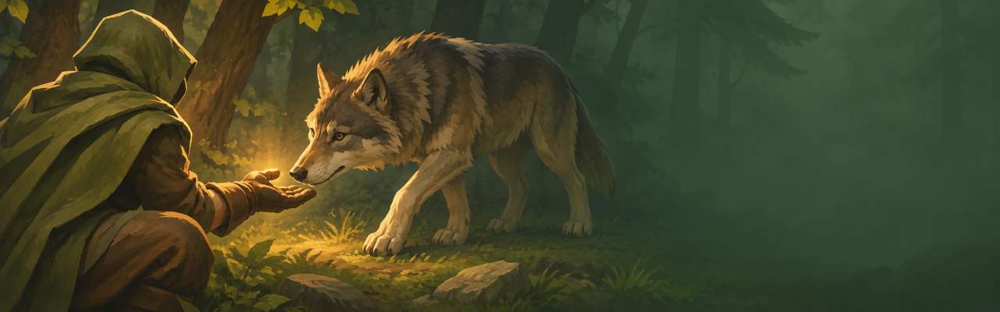

# CurseForge listing

Everything the project form asks for. Paste the description in Markdown mode.

This is what's live for the 0.1.0 test version. Before 1.0, drop the early-testing line, add the artist's credit and "Screenshots are from the real game." to "Good to know", and add real screenshots to the gallery.

| Field | Value |
| --- | --- |
| Game | World of Warcraft |
| Class | Addons |
| Name | Tamer |
| Summary | Shows your Hunter pet's next step: what it can train now, what's next, and which beast teaches what you're missing. |
| Main category | Hunter, under Class, if it's offered |
| Additional categories | Quests & Leveling, if it's offered |
| Allow comments | On |
| Experimental | Off |
| Game version | 1.60.1 (WoW Forever) |
| License | MIT |

## Description

**Your pet just hit level 16. Can it learn something new? Do you even know that rank yet? Where do you find the beast that teaches it?** Tamer answers all three in one small window, so you can stop digging through lists and get back to hunting.

**Tamer is in early testing.** Some ranks don't have a beast in the list yet.

### What it shows

Call your pet and open Tamer. It shows:

- **Ready to train:** ranks you can teach your pet right now, with their training point cost.
- **Next upgrade:** the next rank your pet can learn by leveling, and the level it needs.
- **Go learn it:** ranks your pet's family can learn that you don't know yet. Click one to see the beasts that teach it, closest to your level first, with their level and zone.

Every rank says in plain words what to do next: train it, level up, save training points, or go tame a beast.

### It keeps up with you

When your pet levels into a rank you can teach, Tamer prints one line in chat:

> Behr can now learn Claw (Rank 3). Cast Beast Training to teach it.

That's the only time it speaks up.

### Easy to use

1. Call your pet.
2. Open Beast Training once, so Tamer can see which ranks you know.
3. Click the Tamer icon on the minimap, or type `/tamer`.

### Commands

| Command | What it does |
| --- | --- |
| `/tamer` | Open or close the window |
| `/tamer minimap` | Show or hide the minimap icon |
| `/tamer status` | Print what Tamer can read about you and your pet |
| `/tamer debug` | Print what the game returns, for bug reports |
| `/tamer help` | List the commands |

### Good to know

The beast list is built from public World of Warcraft Classic data, and it's still being checked against Forever. If a beast is in the wrong place or teaches something different on Forever, leave a comment and it'll be fixed. This addon is free, and it isn't affiliated with or endorsed by Blizzard Entertainment.

Found a bug or have an idea? Leave a comment, or open an issue on [GitHub](https://github.com/alexinslc/tamer).
